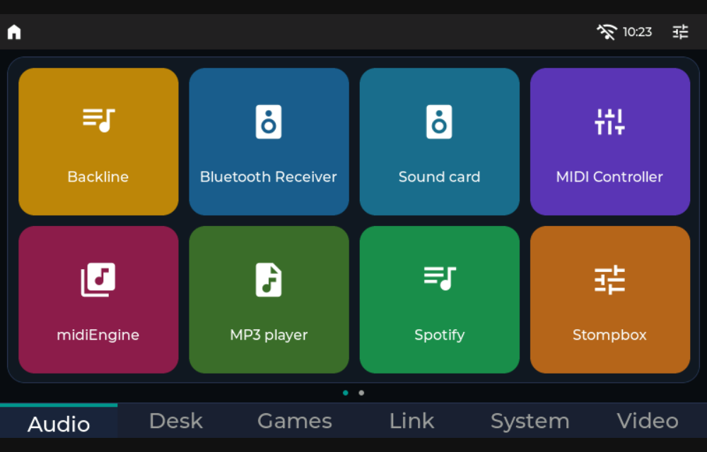

# apps.omnipython.org

Home and every OmniPython app, running in your browser:
<https://apps.omnipython.org/>. Open it and the apps start; install it from
the browser's menu and it opens offline, in its own window.

`?home=watch` starts Watch instead of Home, the watch face with its wheel of
apps, and `?round=1` makes the screen round:
<https://apps.omnipython.org/?home=watch&round=1&width=480&height=480>.

This repository only publishes the page. The page is built by
[omnipython-builds](https://github.com/PyDevices/omnipython-builds/blob/main/docs/guides/build-the-all-apps-page.md),
from the [apps](https://github.com/PyDevices/apps) and
[omnipython](https://github.com/PyDevices/omnipython) repositories, each time
the apps are released. The publish workflow deploys a finished build to this
repository's GitHub Pages site, and run by hand with a build's run id it
puts that build back.

Made by [PyDevices](https://pydevices.com).
